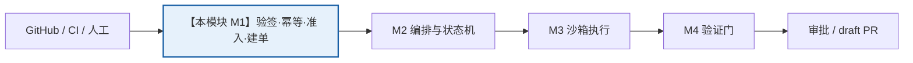
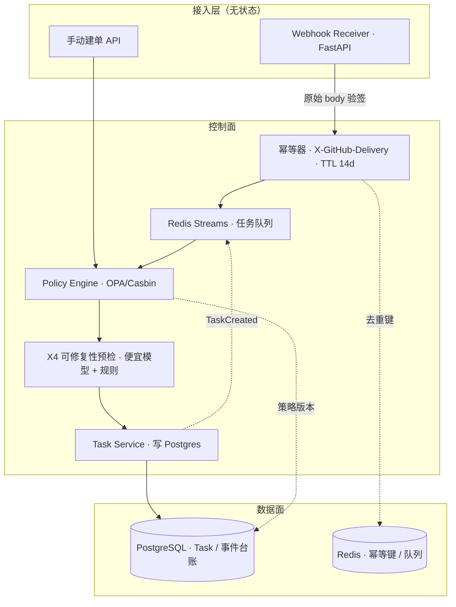

# M1 · 接入与策略准入

> **适用基线**：`PatchPilot-生产级方案.md` v1.2 · **覆盖域**：F1（接入与触发域）、FR-01 / FR-02 / FR-24、X4 准入预检、§2.3 威胁模型入口部分
> **本文自包含**：第 1 节会重述项目定位与本模块在链路中的位置，不需要先读其他文档。

---

## 1. 一分钟读懂

**PatchPilot 是什么**：给一个能由测试判定的缺陷 issue，自动产出可审阅、可验证、可追溯、可回滚的 **draft PR**，合并与否完全由人决定。

**本模块是整条链路的入口**：把外部世界的事件（GitHub webhook、CI 失败、人工建单）变成系统内部一条**合法、唯一、值得修**的 `Task`，然后交给 M2 去编排。它是唯一允许「创建任务」的地方。



**一句话职责**：`外部事件 → 可信的 Task（或带原因码的拒绝）`。

**为什么单独成模块**：最贵的失败不是修错了，而是**跑完整个循环才发现这个任务本来就不该进来**（无法复现、描述含糊、仓库没有可运行测试命令、超出预算或文件禁区）。准入是成本的第一道闸。

---

## 2. 上下游契约

| 方向 | 对象 | 内容 |
|---|---|---|
| **上游输入** | GitHub App webhook | `issues.labeled` / CI 失败事件 / installation 变更；携带 HMAC 签名与 `X-GitHub-Delivery` |
| **上游输入** | 控制面 API | `POST /api/tasks` 手动建单（仓库维护者） |
| **下游输出** | M2 编排 | `TaskCreated{ task, policy_decision, precheck }`，入队后由 Orchestrator 消费 |
| **下游输出（拒绝路径）** | 审计 / 前端 | `Task(state=REJECTED, reason_code, evidence_ref)`，带原因码，前端不显示裸「失败」 |
| **支撑依赖** | 【待拆模块】M9 平台与多租户 | 仓库白名单、配额、`Policy` 版本、`deny_paths` |
| **支撑依赖** | 【待拆模块】M6 安全治理 | OPA 策略引擎裁决、只追加审计、secret 扫描钩子 |
| **支撑依赖** | 【待拆模块】M8 评测与模型网关 | X4 预检用的便宜模型 |

**本模块不改变的事**：不执行任何代码、不调用 agent、不创建 PR、不写业务状态以外的东西。所有「修」的动作都在 M2 之后。

---

## 3. 边界与非目标

| 不做 | 原因 |
|---|---|
| 在 webhook 请求线程里调模型 / 跑测试 | ack 必须 P95 < 2s；慢消费者不能拖垮接入层 |
| 定时扫描全量 open issues | 定时任务仅用于**重试上次失败任务**，避免失控放量 |
| 把 X4 预检做成独立分诊 agent 节点 | 它只是策略引擎的一个字段；新增节点会让 §3 分层变复杂 |
| 签名有效就认为已授权 | 还要校验 installation 是否仍在授权范围 |
| 拒绝时只回「失败」 | 旁路状态必须带原因码 + 证据引用（基线 §1.4） |
| 在线关闭准入门禁 | 对照实验走影子模式 / 离线回放（基线 §1.6 原则 7） |

---

## 4. 架构与组件



**关键分层**：验签与幂等在**接入层**完成（先落队再返回 202）；准入判定与建单在**控制面**完成；两者通过队列解耦，因此队列积压不会影响 webhook 的 ack 时延。

**组件职责**

| 组件 | 职责 | 不负责 |
|---|---|---|
| Webhook Receiver | 原始 body 常量时间 HMAC-SHA256 校验、action 白名单、快速 202 | 业务判定 |
| 幂等器 | 按 `delivery_id` 去重 14 天，重放返回已存在任务 | 生成任务内容 |
| Policy Engine | 静态规则裁决（唯一裁决点） | 模型推理 |
| X4 预检 | 一次便宜模型 + 规则，输出可修复性分与补充信息建议 | 决定该不该修（只是策略的一个字段） |
| Task Service | 创建 `Task`、冻结预算、写 `TaskCreated` 事件 | 驱动状态机（M2 的事） |

---

## 5. 核心流程

```
1 收到 webhook
2 用【原始 body】验签（常量时间比较）；失败 → 401，不落队
3 action / event 白名单过滤；无关事件 → 200 忽略
4 delivery_id 幂等检查：命中 → 返回已有 task_id，结束（不产生第二个任务）
5 落队 → 立即 202 ack
6 消费端：校验 installation 授权范围 → 组装 TaskCandidate
7 Policy Engine 静态准入：仓库白名单 / label / 严重度 / issue 作者权限
                          / 并发 / 预算余额 / deny_paths
8 不通过 → Task(state=REJECTED, reason_code + 证据引用)，写审计，结束
9 X4 预检：便宜模型 + 规则 → fixability_score
   不适合（无法复现 / 描述含糊 / 夹带重构 / 无测试命令）
   → REJECTED + "补充什么信息"的建议
10 通过 → 冻结预算额度、绑定 commit_sha 与 policy_version
11 创建 Task(state=QUALIFIED)，写 TaskCreated 入队
12 交 M2 编排（本模块结束）
```

**触发方式**（基线 §1.4）：① issue 打 `auto-fix` 标签；② CI 失败事件关联到已有 issue；③ 后台手动创建；④ 定时任务**仅重试上次失败任务**。

**状态归属**：本模块只把 `Task` 置为 `QUALIFIED` 或 `REJECTED`；`RECEIVED` 是落队瞬间的中间态，其余状态全部由 M2 驱动。

---

## 6. 技术栈

| 层 | 选型 | 用途 |
|---|---|---|
| HTTP | FastAPI（异步） | webhook 接收与手动建单 API |
| 验签 | `hmac.compare_digest` + HMAC-SHA256 | 常量时间校验，避免时序侧信道 |
| 身份 | GitHub App installation token（约 1h，按仓库/权限收窄） | 由 credential broker 签发，不进沙箱 |
| 幂等 / 队列 | Redis（幂等键 TTL 14d）+ Redis Streams | 去重、先 ack 后处理、慢消费者隔离 |
| 策略 | OPA / Casbin | 静态准入规则，服务端唯一裁决点 |
| 预检 | 便宜模型（经 model gateway）+ 规则检查 | X4 可修复性分 |
| 持久化 | PostgreSQL（事件台账 + Task 表） | 任务与策略版本快照 |
| 观测 | OpenTelemetry + Prometheus | ack 时延、拒绝率、误杀率 |

---

## 7. 数据模型与字段定义

> `【细化】` = 在基线 §4.1 实体之上补充的实现级字段，不改变架构决策。契约以 `packages/contracts` 为准。

**WebhookEnvelope【细化】**（接入层内部，验签后产生）

```ts
type WebhookEnvelope = {
  deliveryId: string;        // X-GitHub-Delivery，幂等键
  event: "issues" | "check_run" | "installation" | "ping";
  action: string;            // 如 "labeled"
  installationId: string;
  repoId: string;
  rawBodySha256: string;     // 原始 body 摘要，验签与审计取证用
  receivedAt: string;        // ISO8601
  signatureValid: boolean;
};
```

**TaskCandidate【细化】**（策略引擎输入）

```ts
type TaskCandidate = {
  tenantId: string;
  repoId: string;
  issueRef: string;          // "acme/order-service#482"
  labels: string[];
  severity?: string;
  authorPermission: "read" | "write" | "admin";
  commitSha: string;         // 触发时仓库 HEAD，后续所有证据都绑定它
  requestedBy: string;
  source: "webhook" | "manual" | "retry";
};
```

**PolicyDecision【细化】**

```ts
type PolicyDecision = {
  allowed: boolean;
  reasonCode: ReasonCode;    // 见 M2 §7 的 ReasonCode 枚举
  policyVersion: string;     // 快照进 Task，保证可回滚与可复现
  budgetFrozen: number;      // 前置冻结额度（X3）
  allowPaths: string[];
  denyPaths: string[];       // 含 .agents/（X10 技能包写入禁区）
  evaluatedAt: string;
};
```

**PrecheckResult【细化】**（X4）

```ts
type PrecheckResult = {
  fixabilityScore: number;   // 0..1
  verdict: "fixable" | "needs_info" | "not_reproducible";
  missingInfo: string[];     // 被拒时给维护者的「补充什么信息」
  model: string;
  modelVersion: string;
  promptVersion: string;
  costTokens: number;
};
```

**Task**（基线 §4.1，本模块负责创建，字段与 v1.2 一致）

```ts
type Task = {
  id: string;                // = thread_id（M2 使用）
  tenantId: string;
  repoId: string;
  issueRef: string;
  state: "RECEIVED" | "QUALIFIED" | "REJECTED";  // 本模块只会置这三个
  reasonCode?: ReasonCode;
  createdBy: string;
  budget: number;
  cost: number;              // 初始 0
  envFingerprint?: string;   // M3 环境准备后回填
  commitSha: string;
  routingProfile: string;    // X11 路由档位配置引用
  skillsContractSha: string; // X10 技能包集合摘要
  policyVersion: string;
  createdAt: string;
};
```

**TaskCreated 内部事件【细化】**

```ts
type TaskCreated = {
  eventId: string;
  taskId: string;
  policyDecision: PolicyDecision;
  precheck: PrecheckResult;
  commitSha: string;
  emittedAt: string;
};
```

---

## 8. 核心 API 与事件

| 方法 | 路径 | 说明 | 权限 |
|---|---|---|---|
| `POST` | `/webhooks/github` | 接收 GitHub 事件；校验 `X-Hub-Signature-256` 与 `X-GitHub-Delivery`；**先落队再 202** | HMAC 验签（内部） |
| `POST` | `/api/tasks` | 手动建单，body 为 `TaskCandidate` 的子集 | 仓库维护者 |
| `GET` | `/api/tasks/{id}` | 查任务快照（含拒绝原因码） | 租户成员 |
| `GET` | `/api/policies` / `PUT` | 策略与版本（M9 展开） | 平台管理员 |

**内部接口（非 HTTP）**

```ts
interface PolicyEngine {
  evaluate(candidate: TaskCandidate): PolicyDecision;   // 纯函数、确定性、可回放
}
interface Precheck {
  assess(candidate: TaskCandidate, policy: PolicyDecision): Promise<PrecheckResult>;
}
interface TaskQueue {
  enqueueTaskCreated(event: TaskCreated): Promise<void>; // 幂等键 = event.taskId
}
```

**响应约定**：统一 `{ code, message, traceId, retryable, evidenceRef? }`；`code` 与 `ReasonCode` 对齐。被拒时 `evidenceRef` 指向策略判定日志，供审计完整重放。

**对外发出的 SSE 事件**（M2 消费后由事件流暴露给前端）：`kind: "policy"`（准入裁决）、`kind: "state"`（QUALIFIED / REJECTED）。

---

## 9. 关键机制（为什么这么设计）

1. **原始 body 验签**：任何解析后重新序列化的 body 都会改变摘要；必须用未经处理的字节做 HMAC。常量时间比较避免时序泄漏。
2. **签名有效 ≠ 已授权**：installation 可能已被卸载或权限收窄；每次都要查授权范围，否则会给已失权的仓库开任务。
3. **先落队再 202**：模型、策略、数据库都可能慢；webhook 的 ack SLA（P95 < 2s）不能依赖它们。
4. **delivery 级幂等**：webhook 重放、CI 重跑、人工重复提交都会产生相同输入；去重键是 `delivery_id`，TTL 14 天（覆盖 GitHub 的重投窗口）。
5. **X4 不是新 agent**：基线 §2.6.4 明确它是策略引擎的一个字段。一次便宜模型分类换掉整任务成本，误杀率可在离线回放测量。
6. **预算前置冻结**：X3 要求建任务时按 issue 类型 / 仓库规模估算并冻结额度；不冻结会让多个并发任务打穿配额。
7. **`commit_sha` 在建单时锁定**：后续 M3 只读挂载、M4 证据包、Check Run 全部绑定这个 SHA；不锁定分支 HEAD 会让证据与代码版本错配。

---

## 10. 失败、降级与安全

| 场景 | 行为 |
|---|---|
| 伪造 / 篡改签名 | 401，不落队，写安全审计 |
| 重放同一 delivery | 返回已有 `task_id`，**不产生第二个任务** |
| installation 已卸载 / 失权 | `REJECTED(POLICY_DENIED)`，之后不再接收该 installation 的新任务 |
| 策略引擎不可用 | **fail-closed**：拒绝新任务并告警，不绕过准入 |
| X4 预检模型 429 / 5xx | 按 X2 `RetryPolicy` 指数退避，有上限；仍失败则转人工判定而非静默放行 |
| 预算余额不足 / 并发打满 | `REJECTED(BUDGET_EXHAUSTED)` 或排队，配额熔断由 M6/M9 执行 |
| 事件进入文件禁区 | `POLICY_DENIED`，`deny_paths` 含测试/CI/锁文件/infra/`.agents/` |
| 注入型 issue 正文 | 正文始终是不可信数据；本模块不执行它，最终控制面在 M3 的 egress 与工具白名单 |

**降级阶梯**（X2）：模型不可用 → 规则兜底；策略不可用 → 停新任务、保留在途状态。**降级降的是自动化程度，不是安全级别**。

---

## 11. 可观测与验收

| 指标 | 目标 |
|---|---|
| webhook ack | P95 < 2s，且不受后端模型/策略耗时影响 |
| 重放同一 delivery | 只生成一个 Task（验收用对抗用例） |
| 伪造签名 | 401 且写审计 |
| 卸载 installation 后 | 立即停止新任务 |
| X4 误杀率 | 离线回放可测：被拒任务确实无法产出可合并 PR |
| 预检成本 / 避免的整任务成本 | 比值可测，写入 M8 评测报告 |
| 每次拒绝 | 带 `reason_code + evidence_ref`，审计可完整重放 |

**日志字段**：`delivery_id / installation_id / repo_id / issue_ref / policy_version / reason_code / trace_id / delivery_latency_ms`。

---

## 12. 贯穿示例 + 接口速查

**issue #482 在本模块的经过**

1. 维护者给 `acme/order-service#482` 打上 `auto-fix` → GitHub 发 `issues.labeled`，`delivery_id = D-9f3…`。
2. Receiver 用原始 body 过 HMAC → 通过；`D-9f3…` 未命中幂等键 → 落队 → 返回 `202 { taskPending: true }`。
3. 消费端确认 installation 仍授权；组装 `TaskCandidate{ issueRef: "acme/order-service#482", commitSha: "a1b2c3d", labels: ["auto-fix"] }`。
4. Policy Engine：仓库在白名单、label 命中、作者有 write 权限、并发未满、预算余额充足、无文件禁区冲突 → `allowed=true`，冻结额度，`policy_version=pv-17`。
5. X4 预检：issue 描述明确、关联 `tests/test_cart.py::test_coupon_stack`、仓库有可运行测试命令 → `verdict=fixable, fixabilityScore=0.86`。
6. 创建 `Task(tsk_01H…, state=QUALIFIED, commitSha=a1b2c3d, policyVersion=pv-17)`，发出 `TaskCreated` → **M2 接手**。

如果第 4 步预算不足，则创建 `Task(state=REJECTED, reason_code=BUDGET_EXHAUSTED)`，前端显示「预算不足」+ 证据引用，链路到此结束（这仍是一个完整闭环）。

**接口速查**

| 我给谁 | 给什么 |
|---|---|
| M2 | `TaskCreated{ taskId, policyDecision, precheck, commitSha }` |
| M6 / M9 / M8（待拆） | 审计事件、策略版本读取、便宜模型调用 |
| 前端（经 M2 事件流） | `kind: "policy"` / `kind: "state"` |

**延伸阅读**：基线 §2.1（FR-01/02/24）、§2.3、§2.6.4（X4）、§3.2 步骤 1–2、F1 要点；下一站 [`M2-任务编排与状态机.md`](./M2-任务编排与状态机.md)。
