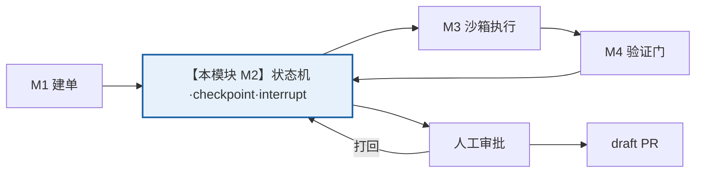
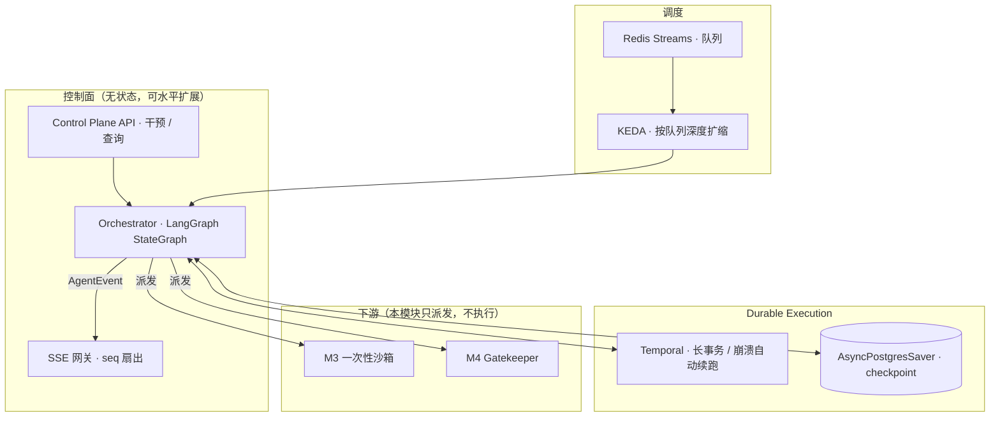
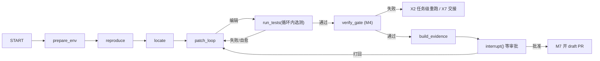

# M2 · 任务编排与状态机

> **适用基线**：`PatchPilot-生产级方案.md` v1.2 · **覆盖域**：F2（任务编排与调度域）、§3.2 时序、§4.2 状态与事件枚举、§4.4 实时事件协议、X2 / X5 / X7、§2.6.2
> **本文自包含**：第 1 节重述项目定位与本模块在链路中的位置，不需要先读其他文档。

---

## 1. 一分钟读懂

**PatchPilot 是什么**：给一个能由测试判定的缺陷 issue，自动产出可审阅、可验证、可追溯、可回滚的 **draft PR**，合并与否完全由人决定。

**本模块是全链路的中枢**：把 M1 创建的一条 `Task` 变成一条**可暂停、可恢复、可打回、崩溃可续跑**的执行链。它自己不改代码、不跑测试，只负责「谁在什么时候该做什么、状态是什么、失败了往哪走」。



**一句话职责**：`Task → 驱动状态机 → 挂起等人 / 结束（每个状态都可恢复、可审计）`。

**为什么单独成模块**：基线 §2.4 约束 4 要求「状态持久化与无状态计算分离」。任务会跑很久、会等人审批、worker 会被杀；如果状态和计算绑在一起，任何一次重启都会丢任务或重复开 PR。**状态机是全系统唯一权威的运行真相**。

---

## 2. 上下游契约

| 方向 | 对象 | 内容 |
|---|---|---|
| **上游** | M1 | `TaskCreated{ taskId, policyDecision, precheck, commitSha }` |
| **上游** | 人工 / 前端 | 暂停、继续、取消、接管、追加指令、批准、打回 |
| **下游** | M3 执行沙箱 | `ExecutionDispatch{ taskId, runId, commitSha, envFingerprint, policyVersion }`，收回 `PatchCandidate` |
| **下游** | M4 验证门 | `VerificationRequest`（由 M3 产出 diff 后触发），收回 `GateResult + Evidence` |
| **下游** | 前端（经 SSE） | `AgentEvent[]`（`seq` 单调、可回放） |
| **下游** | 【待拆模块】M7 PR 交付 | 审批通过后触发开 draft PR |
| **支撑依赖** | 【待拆模块】M10 前端 | 事件 reducer 消费、审批台交互 |
| **支撑依赖** | 【待拆模块】M6 / M9 | 策略版本、配额熔断、审计 |

---

## 3. 边界与非目标

| 不做 | 原因 |
|---|---|
| 在编排进程里执行模型生成的代码 | 基线 §2.4 约束 1：控制面与执行面不共享进程/文件系统/凭证 |
| 把大日志 / 大 diff 塞进 state | 每个 super-step 都序列化 state，会拖垮 checkpoint（X1） |
| 把「测试没过」当 retry | 业务性失败是 **agent 循环的正常回边**，不是框架级重试（X2） |
| 让 checkpointer 承担崩溃自动续跑 | checkpoint 只存状态；自动续跑由 Temporal 承担 |
| 计划审批（每步都等人） | 仅 PR 创建一处 `interrupt()`；短任务不该卡在等人 |
| 提供「关掉迭代上限/预算」的开关 | 它们是上线常量；对照走影子/离线（基线 §1.6 原则 7） |

---

## 4. 架构与组件



| 组件 | 职责 | 为什么需要 |
|---|---|---|
| `StateGraph` | 表达回边（改码 ⇄ 测试）、条件边、`interrupt` | 无状态链表达不了循环与挂起 |
| `AsyncPostgresSaver` | 每个 super-step 持久化 state（checkpoint） | worker 无状态，任一实例凭 `thread_id` 接管 |
| Temporal | 进程崩溃后的自动续跑、长事务编排 | **checkpointer 不等于自动续跑**，两者职责不同 |
| Redis Streams + KEDA | 队列与按深度扩缩 | 削峰、公平调度 |
| SSE 网关 | `seq` 生成、窗口保留、扇出 | 前端可回放、断线续传 |

**工作者单元是任务而非文件**：控制面主界面围绕 `Task` 组织（基线 §3.4）。

---

## 5. 核心流程与状态机

**任务状态机**（前后端共用同一枚举，基线 §4.2）

```
RECEIVED → QUALIFIED → ENV_READY → REPRODUCING → PATCHING → VERIFYING
         → EVIDENCE_READY → AWAITING_APPROVAL → PR_CREATED → MERGED / CLOSED
旁路：REJECTED（策略拒绝） / PAUSED（人工暂停） / CANCELLED / FAILED
      / TIMED_OUT / BUDGET_EXCEEDED / QUARANTINED（安全事件隔离）
```

> **任何旁路状态必须带原因码 + 证据引用**，前端不得只显示「失败」。

**编排图（节点级）**



**一次任务的 12 步**（基线 §3.2，标出本模块负责的部分）：

| 步 | 动作 | 归属 |
|---|---|---|
| 1–2 | webhook 验签 / 策略准入 | M1 |
| 3 | **创建 `thread_id = task_id`，工作流启动写 checkpoint** | **M2** |
| 4 | 准备环境（只读挂载指定 commit SHA） | M3（M2 派发） |
| 5 | 复现失败 | M3 |
| 6 | 定位 | M3 + M5 |
| 7 | **修复循环（含 X10 技能装配、X11 分档、循环内选测）** | M3（M2 驱动边界） |
| 8 | **Gatekeeper 独立验证** | M4（M2 派发） |
| 9 | **证据包落对象存储 → `EVIDENCE_READY` → `interrupt()` → `AWAITING_APPROVAL`** | **M2** |
| 10 | 审批台；批准 → draft PR；打回 → 回到步骤 7（有次数上限） | M2 + M7 + M10 |
| 11–12 | 仓库 CI、结果/成本/人工决定写回评测与审计 | M7 / M8 |

**关键时序约定（v1.2 修订，勿改）**：X11 的档位升级信号只来自**循环内 `run_tests` 失败**等客观信号；**Gatekeeper 失败不触发同 attempt 内升级**——它在最终验证门才执行一次，此时换模型重编辑会导致全量回归跑第二次（破坏 X6「全量套件执行次数 = 1」）。Gatekeeper 失败归 **X2 任务级重跑或 X7 转人工交接**。

---

## 6. 技术栈

| 层 | 选型 | 用途 |
|---|---|---|
| 编排 | LangGraph `StateGraph`（`add_conditional_edges` / `Command` / `Send` / subgraph） | 回边、条件路由、挂起 |
| 持久化 | `AsyncPostgresSaver` + `durability="sync"`，`thread_id = task_id` | checkpoint |
| 自动续跑 | Temporal（长事务与崩溃恢复） | 与 checkpointer 分工 |
| 队列 / 扩缩 | Redis Streams + KEDA | 短任务与弹性 |
| 状态校验 | Pydantic v2 | state schema、事件 payload |
| 实时通道 | SSE（`seq` + `Last-Event-ID`） | 服务端单向、可回放、鉴权简单 |
| 观测 | OTel + LangFuse + Prometheus | 任务 → 节点 → 模型 → 工具 → 成本 |

---

## 7. 数据模型与字段定义

> 基线 §4.1 / §4.2 / §4.4 的可读展开；`【细化】` 为补充的实现级契约。

**TaskState 与 ReasonCode**（基线 §4.2，原样）

```ts
type TaskState =
  | "RECEIVED" | "QUALIFIED" | "ENV_READY" | "REPRODUCING" | "PATCHING"
  | "VERIFYING" | "EVIDENCE_READY" | "AWAITING_APPROVAL" | "PR_CREATED"
  | "MERGED" | "CLOSED"
  | "REJECTED" | "PAUSED" | "CANCELLED" | "FAILED"
  | "TIMED_OUT" | "BUDGET_EXCEEDED" | "QUARANTINED";

type ReasonCode =
  | "POLICY_DENIED" | "NO_REPRO" | "VERIFY_FAILED" | "DIFF_OUT_OF_SCOPE"
  | "ANTI_CHEAT" | "EGRESS_BLOCKED" | "BUDGET_EXHAUSTED" | "TIMEOUT"
  | "MODEL_ERROR" | "HUMAN_REJECTED" | "SECURITY_INCIDENT";
```

**Run**（基线 §4.1，v1.2 扩展）

```ts
type Run = {
  id: string;
  taskId: string;
  threadId: string;          // = taskId
  attemptNo: number;         // 打回重跑 +1，成本单独记账
  checkpointRev: number;
  modelProfile: string;       // 初始档位（X11）
  initialTier: "cheap" | "standard" | "frontier";
  tierHistory: TierHistoryEntry[];      // 档位变化逐条记录
  routingConfigVersion: string;         // 阈值版本快照，保证可复现
  contextAccountRef: string;            // 上下文账对象存储引用
  startedAt: string;
  endedAt?: string;
};
```

**RunState【细化】**（LangGraph state，与持久化的 `Run` 实体区分）

```ts
type RunState = {
  taskId: string;
  phase: TaskState;
  attemptNo: number;

  // 只存「结论 + 引用」，大对象放对象存储（X1）
  diffRef?: string;
  testResultRef?: string;
  evidenceRef?: string;
  excludedApproaches: string[];      // 压缩时必须保留（防止反复踩同一个坑）
  budgetUsed: { tokens: number; wallMs: number; toolCalls: number; sandboxMinutes: number };

  // 质量检测
  lastErrorFingerprint?: string;     // X5 无进展指纹
  noProgressCount: number;           // 升级不重置该计数器（§2.6.6）
  iterationCount: number;

  // 可复现（X1 + X10/X11）
  promptVersion: string;
  indexSnapshotRef?: string;
  skillsLoaded: { skillId: string; version: string; source: "prefetch" | "request" }[];
  routingDecisionRef?: string;
};
```

**Checkpoint【细化】**

```ts
type Checkpoint = {
  threadId: string;
  checkpointRev: number;
  stateBlobRef: string;      // state 序列化结果；大对象只存引用
  nodeId: string;
  createdAt: string;
  traceId: string;
};
```

**AgentEvent**（基线 §4.4，含 v1.2 新增的两个 kind）

```ts
type AgentEvent = {
  seq: number;               // 每任务单调递增，用于排序与去重
  taskId: string;
  ts: string;                // ISO8601
  kind: "state" | "token" | "node" | "tool" | "test" | "policy" | "approval" | "error"
      | "skill" | "routing";
  phase: TaskState;
  payload: unknown;          // 按 kind 用 discriminated union 收窄
  traceId: string;
};
```

> **向前兼容硬要求**：前端 reducer 对未知 `kind` **必须忽略而非报错**；旧客户端收到新事件不得崩溃，事件序列回放测试对新增 kind 全绿。

**TierHistoryEntry / RoutingDecision【细化】**（X11，v1.2）

```ts
type TierHistoryEntry = {
  from: Tier; to: Tier; reason: "test_failed" | "schema_invalid" | "no_progress" | "context_overflow";
  attemptNo: number; seq: number; at: string;
};
type RoutingDecision = {
  tier: Tier;
  signals: { name: string; value: number; weight: number; contribution: number }[];
  thresholdHit: string;
  configVersion: string;
  plannedEditUnitRef: string;   // 先验特征，不能用编辑后产物
};
```

---

## 8. 核心 API 与事件

| 方法 | 路径 | 用途 | 权限 |
|---|---|---|---|
| `POST` | `/api/tasks/{id}/pause\|resume\|cancel\|steer` | 干预操作（暂停 / 继续 / 取消 / 追加指令） | 仓库维护者 |
| `GET` | `/api/tasks/{id}` | 任务快照 + 证据引用 | 租户成员 |
| `GET` | `/api/tasks/{id}/events` | SSE 事件流（`Last-Event-ID`） | 租户成员 + 短期 ticket |
| `POST` | `/api/tasks/{id}/approval` | 批准 / 打回 + 逐行评论 | 审阅者（非发起人） |
| `GET` | `/api/tasks/{id}/evidence` | 证据包下载 | 审阅者 |

**内部接口（非 HTTP）【细化】**

```ts
interface Orchestrator {
  start(cmd: TaskCreated): Promise<{ threadId: string; runId: string }>;
  resume(threadId: string, decision: ApprovalDecision): Promise<void>;
  handleToolResult(runId: string, result: ToolResult): Promise<void>;  // 回边
  signal(s: "PAUSE" | "RESUME" | "CANCEL" | "STEER", payload?: unknown): Promise<void>;
}
```

**事件可靠性**：`EventSource` 携带 `Last-Event-ID` 断线续传；服务端在 Redis 保留最近 N 条，超窗则先拉快照再续流；`seq` 去重与乱序丢弃在前端 reducer；测试日志窗口化 + 背压，禁止无限 append。三种流为 `messages` / `updates` / `custom`（测试输出），`values` / `debug` 只做内部诊断。

**干预动作的副作用**：不可逆操作（审批、取消）不做乐观更新；每个动作二次确认 + 审计记录。

---

## 9. 关键机制（为什么这么设计）

1. **`thread_id = task_id`**：一个任务一条工作流，checkpoint 按它存取，任何 worker 凭它接管，天然满足「控制面无状态」。
2. **`interrupt()` 恢复时节点从顶部重执行**：因此前置副作用（发通知、建分支、写 PR）必须幂等，幂等键 = `task_id + step + payload hash`。否则打回重跑会开出第二个 PR。
3. **checkpoint ≠ 崩溃自动续跑**：checkpointer 只存状态；进程被杀后由 Temporal 重新拉起工作流。这是基线 §2.4 约束 8 最容易混淆的一点。
4. **业务性失败是回边不是 retry**（X2）：测试没过、定位方向错 → 错误分类后回填 coder 重新推理，属 agent 循环正常路径；框架级 `RetryPolicy` 只处理 429/5xx、网络抖动、沙箱启动失败等瞬时故障。
5. **任务级重跑 = 新 `Run`**：人工打回、低置信度 best-of-N 都开新 attempt，独立记录、成本单独记账；逐轮过程数据（`tier_history`、上下文账）放在 `Run`/`Evidence`，**不放 `Task`**，否则重跑会覆盖旧值。
6. **X5 无进展早停**：现有只有迭代数 / 预算这类**数量**上限，没有**质量**上限；对连续 attempt 的 diff 与测试错误做指纹比对，重复或停滞即终止并生成 X7 交接包。
7. **X7 交接包**：失败 / 超时 / 超预算 / 打回时输出已定位文件、已排除方案、最小复现命令、失败测试、当前 diff、建议从哪一步接手——让人工介入成本最低。
8. **X2 降级阶梯优先于 X11 单元级分档**：逼近预算时任务级降档优先，且降级路径不触发 X11 升级，避免「降档 + 升档」拉扯。
9. **审批等待不占计算资源**：`interrupt()` 挂起，状态留在 Postgres；这是「长任务与人工审批可恢复」的核心。

---

## 10. 失败、降级与安全

| 触发 | 动作 | 始终不变 |
|---|---|---|
| 昂贵模型不可用 / 逼近预算 | 便宜模型 → 规则兜底 | 验证门 |
| 自动修复反复失败 | 带完整上下文与证据转人工（X7） | 验证门 |
| RAG 不可用 | 退化为符号检索 / grep | 验证门 |
| 沙箱不可用 | 只出只读诊断报告，不写 PR | 验证门 |
| 出网被拒 | 用缓存依赖继续执行 | egress 策略 |
| 配额耗尽 | 停止新任务，保留在途状态可恢复 | 审计与分支保护 |
| worker 被杀 | 另一实例从最近 checkpoint 续跑，不重复副作用 | 幂等键 |
| 安全事件 | 自动 `QUARANTINED` + 吊销 token + 保留日志 | 不可委托决策清单 |

**原则**：降级降的是自动化程度，不是安全级别；任何降级路径都不得关闭验证门、diff 规则、审计与分支保护。验收以「kill worker / 配额打满 / 模型超时后是否保住状态并优雅转人工」为准，**不演示「不拦会怎样」**。

---

## 11. 可观测与验收

| 指标 | 目标 |
|---|---|
| kill worker 后 | 另一实例从最近 checkpoint 续跑且不重复副作用 |
| 暂停 24h 后恢复 | 状态不丢 |
| 取消 | 立即释放沙箱 |
| 全量回归执行次数 | 恒 = 1（由 M3/M4 共同保证，M2 不重复派发验证门） |
| 事件流 | 断网重连无事件丢失；新 `kind` 不破坏既有 reducer |
| SSE 首事件 | P95 < 3s |
| trace | 任一任务可重建「状态 → 节点 → 模型 → 工具 → 成本」完整路径 |

**成本归因**：按租户 / 仓库 / 任务 / 节点 / tier 五维出账；打回重跑的 `Run` 单独记账。

---

## 12. 贯穿示例 + 接口速查

**issue #482 在本模块的经过**

1. M1 发来 `TaskCreated(tsk_01H…, commitSha=a1b2c3d, policyVersion=pv-17)` → `start()` 建 `thread_id = tsk_01H…`、`Run(attempt_no=1)`、首个 checkpoint（`checkpoint_rev=1`）。
2. 状态机推进 `QUALIFIED → ENV_READY → REPRODUCING → PATCHING`；派发 `ExecutionDispatch` 给 M3。
3. M3 回报「循环内目标测试通过」→ M2 派发 `VerificationRequest` 给 M4 → 状态 `VERIFYING`。
4. M4 回报 `GateResult(passed=true)` + 证据包 `object_key` → 状态 `EVIDENCE_READY` → `interrupt()` → `AWAITING_APPROVAL`，**不占计算资源**。
5. 审阅者在审批台打回一条评论 → `resume()` 开 `Run(attempt_no=2)`，评论作为结构化反馈回灌，回到 `PATCHING`（有次数上限）。
6. 第二次验证通过、批准 → M7 开 draft PR → `PR_CREATED`；结果、成本、人工决定写回评测与审计。
7. 若第 4 步 M4 返回 `passed=false`：不触发 X11 的 attempt 内升级，而是走 X2 任务级重跑或 X7 交接包；全量套件执行次数仍为 1。

期间前端持续收到 `AgentEvent`：`state`（状态迁移）、`node`（节点进出）、`tool`（工具调用）、`test`（测试实时输出）、`skill`（技能加载）、`routing`（档位切换）——按 `seq` 参与 event-sourced reducer，可完整回放。

**接口速查**

| 谁 | 给什么 / 收什么 |
|---|---|
| M1 → M2 | `TaskCreated` |
| M2 → M3 | `ExecutionDispatch`；收 `PatchCandidate` |
| M2 → M4 | `VerificationRequest`；收 `GateResult + Evidence` |
| M2 → 前端 | `AgentEvent[]`（SSE）+ REST 快照 |
| M2 → M7（待拆） | 审批通过 → 开 draft PR |

**延伸阅读**：基线 §2.6.2（X2）、§2.6.4（X5/X7）、§3.2、§4.2 / §4.4、F2 要点；上一站 [`M1-接入与策略准入.md`](./M1-接入与策略准入.md)，下一站 [`M3-执行沙箱与ACI工具层.md`](./M3-执行沙箱与ACI工具层.md)。
