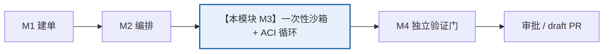
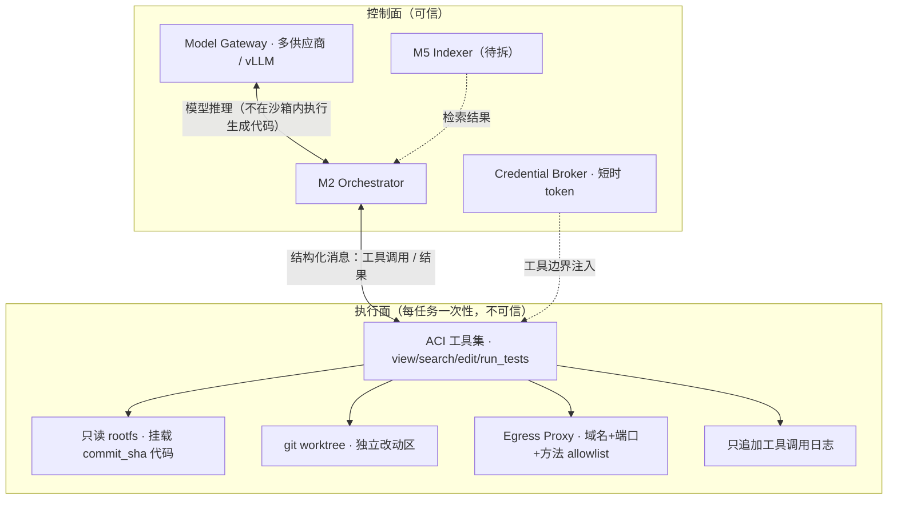

# M3 · 执行沙箱与 ACI 工具层

> **适用基线**：`PatchPilot-生产级方案.md` v1.2 · **覆盖域**：F3（执行沙箱与环境域）+ F4（工具层与 Agent 循环域）、X1 / X6 / X10 / X11、§3.1 三条硬边界
> **本文自包含**：第 1 节重述项目定位与本模块在链路中的位置，不需要先读其他文档。

---

## 1. 一分钟读懂

**PatchPilot 是什么**：给一个能由测试判定的缺陷 issue，自动产出可审阅、可验证、可追溯、可回滚的 **draft PR**，合并与否完全由人决定。

**本模块是「真正动手改代码」的地方，也是安全边界最厚的地方**：M2 派发任务后，系统开一个**一次性、默认无出网、只读挂载**的沙箱，在里面复现失败、定位、用四个受限工具改码、循环内跑受影响的测试，最后交出一份**候选 diff**。



**一句话职责**：`ExecutionDispatch → 候选 diff + 日志`（**不判断自己修得对不对**，那是 M4 的事）。

**为什么单独成模块**：基线 §1.1 把首要难点定为「执行不可信代码的安全性」。issue 正文、代码注释、依赖文档、测试输出都是不可信输入，模型生成的代码是不可信执行体；隔离按「容器会被打穿」设计。同时这里也是 token / 机时消耗的主战场，X10 技能披露与 X11 模型分档都落在这里。

---

## 2. 上下游契约

| 方向 | 对象 | 内容 |
|---|---|---|
| **上游** | M2 | `ExecutionDispatch{ taskId, runId, commitSha, envFingerprint, policyVersion, budget, tier? }` |
| **上游** | 【待拆模块】M5 代码检索 | 增量索引 + 符号表 + 混合检索结果，绑定 `commit_sha`（本模块只消费，不实现） |
| **下游** | M4 | `PatchCandidate{ diffRef, filesChanged[], hunks[], testsRun[], commitSha, contextAccount, routingAccount }` |
| **下游** | M2 | `AgentEvent(kind=tool/test/skill/routing)`、错误分类、提前终止信号 |
| **支撑依赖** | 【待拆模块】M6 安全治理 | 工具 allow/deny/ask 策略、egress proxy、短时凭证 broker、审计 |
| **支撑依赖** | 【待拆模块】M8 模型网关 | 多供应商 / vLLM 自托管模型调用，`usage_metadata` 计量 |
| **支撑依赖** | 【待拆模块】M9 | 镜像、配置版本、配额 |

---

## 3. 边界与非目标

| 不做 | 原因 |
|---|---|
| 判断「真的修好了」 | 验证只在 M4 的独立评分环境做；同 writable 域下测试夹具可被改写制造假通过 |
| 跑全量回归 | 循环内只按影响分析选测（X6）；**全量套件只在 M4 恰好执行一次** |
| 在编排进程里执行模型生成的代码 | 控制面 / 执行面不共享进程、文件系统、凭证（§3.1） |
| 新增第 5 个 ACI 工具（如 `load_skill`） | 工具数量是每轮常驻税；技能请求走结构化输出字段（X10） |
| 让模型自由检索技能目录 / 技能正文嵌套引用 | 召回失败代价是用错规程；加载会退化为无界图遍历 |
| 把大日志 / 大 diff 放进编排 state | 每个 super-step 都序列化 state（X1） |
| 把凭证挂进沙箱 | 短时 token 由沙箱外 broker 签发，凭证只在工具边界注入 |

---

## 4. 架构与组件



**三条硬边界**（基线 §3.1）：

1. **控制面与执行面不共享进程 / 文件系统 / 凭证**。
2. **执行面默认无出网**，仅经 egress proxy，且依赖安装阶段与 agent 执行阶段的网络策略分离。
3. **Gatekeeper（M4）在独立环境复跑验证**，agent 无法写入评分环境。

**模型推理与代码执行的分离**：模型调用发生在控制面侧（经 model gateway），返回的是结构化工具调用意图；真正的文件读写、测试执行发生在沙箱内。模型生成的**代码不进入编排进程**——这是 §2.4 约束 1 的落点。

| 组件 | 职责 |
|---|---|
| Sandbox (gVisor/Kata) | 独立内核/netns、只读根 fs、`no-new-privileges`、seccomp/AppArmor、cgroups v2、硬超时、结束即销毁 |
| git worktree | 每任务独立工作区，避免并行任务互相踩踏 |
| ACI 工具集 | 四个受限工具，按执行面绑定不同白名单 |
| Egress Proxy | 域名 + 端口 + **HTTP 方法**三级 allowlist、DNS 受控、阻断 `169.254.169.254` 等元数据地址、记录被拒请求 |
| Credential Broker | 沙箱外签发约 1h 的 installation token；私钥与 KMS 不挂载 |

---

## 5. 核心流程

```
1 收 ExecutionDispatch → 创建一次性沙箱（固定镜像 digest + 资源限额 + 硬超时）
2 依赖安装阶段：受限出网装依赖；生成 env_fingerprint（此阶段与 agent 阶段网络策略分离）
3 只读挂载 commit_sha 代码 + .agents/skills/ 技能包（X10，随同一 commit 绑定）
4 复现失败：跑与 issue 关联的测试 / 最小复现；无法复现 → 回 M2 转人工
5 定位：调 M5 索引 + 符号表 + 混合检索 → 候选文件与上下文（受 token 预算约束）
6 进入 PATCHING：X10 按 (phase, surface) 装配技能；X11 用先验 rubric 为编辑单元选档
7 ACI 循环：
   view / search → 模型产出结构化编辑 → edit（语法校验后写入）
   → run_tests(affected) → 失败分类 → 回填自愈（回边，不是 retry）
8 循环内目标测试通过 → 组装 PatchCandidate（diff 只存对象存储引用）
9 交 M4 独立验证；本沙箱随后销毁（卷与 netns 不残留）
```

**X11 升级时序（v1.2 口径）**：只有「循环内 `run_tests` 失败 / 结构化输出连续失败 ≥2 / X5 无进展指纹 / X1 裁剪后仍失败」触发同 attempt 内单向升级（≤2 次）；**Gatekeeper 失败不属于这里**。

---

## 6. 技术栈

| 层 | 选型 | 用途 |
|---|---|---|
| 隔离 | gVisor / Kata（可选 Firecracker 微 VM） | 普通容器共享内核，对生成代码是弱边界 |
| 内核加固 | 只读 rootfs + `no-new-privileges` + seccomp / AppArmor + cgroups v2 | 资源与 syscall 限制 |
| 网络 | network namespace + Envoy / Squid egress proxy | 默认拒绝 + 方法级 allowlist + 拒答日志 |
| 环境可复现 | 固定基础镜像 + 锁文件 + 依赖缓存 + Syft/Grype 扫描 | `env_fingerprint` 进证据包 |
| Agent 循环 | LangChain `bind_tools` / `with_structured_output` / `trim_messages` / `BaseCallbackHandler`；LangGraph `ToolNode` + `tools_condition` | 工具绑定、结构化输出、上下文裁剪 |
| 校验 | Pydantic v2 | 工具参数与结构化输出 schema |
| 模型 | 自研 model gateway（多供应商 + vLLM 自托管） | X11 三档路由；`AIMessage.usage_metadata` 计量 |
| 代码索引 | tree-sitter（由 M5 提供） | 定位用的符号表 |

---

## 7. 数据模型与字段定义

> `【细化】` 为在基线原则下补充的实现级契约；`packages/contracts` 为准。

**ExecutionDispatch【细化】**（M2 → M3）

```ts
type ExecutionDispatch = {
  taskId: string;
  runId: string;
  attemptNo: number;
  commitSha: string;              // 只读挂载的代码版本
  envFingerprint?: string;
  policyVersion: string;
  budget: { tokens: number; wallMs: number; toolCalls: number; sandboxMinutes: number };
  routingProfile: string;
  skillsContractSha: string;      // 技能包集合摘要，防漂移
  issueRef: string;
  targetTests: string[];
};
```

**SandboxSpec【细化】**

```ts
type SandboxSpec = {
  imageDigest: string;
  commitSha: string;
  envFingerprint: string;
  networkPolicy: "install-only" | "deny-all";
  resourceLimits: { cpu: string; mem: string; pids: number };
  ttlSeconds: number;
  denyPaths: string[];            // 含 tests / CI / 锁文件 / infra / .agents/
  rootfsReadOnly: true;
};
```

**四个 ACI 工具（核心契约）【细化】**

```ts
// 只有这四个工具；每个执行面绑定不同白名单
view(path: string, startLine?: number, endLine?: number)
  -> { path: string; lines: string[]; totalLines: number; truncated: boolean };

search(query: string, path?: string, limit?: number)
  -> { hits: { file: string; line: number; snippet: string; score: number }[] };

edit(path: string, hunks: { startLine: number; endLine: number; replacement: string }[],
     syntaxCheck?: boolean = true)
  -> { ok: boolean; diffRef: string; errors: string[] };

run_tests(scope: { mode: "affected" | "target"; targets?: string[] })
  -> { passed: boolean; failures: { test: string; errorClass: "compile"|"assert"|"timeout"; message: string }[];
       logRef: string; durationMs: number };
```

> `run_tests` **没有 `mode: "all"`**：全量回归只在 M4 的验证门执行一次（X6）。这是接口层面的防呆。

**执行面 × 工具白名单**

| surface | view | search | edit | run_tests | 说明 |
|---|---|---|---|---|---|
| `locator` | ✅ | ✅ | ❌ | ❌ | 只读定位，无写权 |
| `coder` | ✅ | ✅ | ✅ | ✅ | 无出网；X11 三档路由只作用于这里 |
| `gatekeeper` | ✅ | ✅ | ❌ | ❌ | 在 M4 的独立环境，agent 进程无权干涉 |

**结构化输出 schema【细化】**（含 X10 的 `need_skill`）

```ts
type AgentTurn = {
  reasoning: "conclusion-only";  // state 只存结论，不存长思维链
  edits?: { path: string; hunks: Hunk[] }[];
  needSkill?: string[];          // 模型请求技能；编排层校验后才注入正文
  done: boolean;
};
```

**X10 / X11 相关字段【细化】**（规格见基线 §2.6.5 / §2.6.6）

```ts
type SkillLoadRecord = { taskId: string; attemptNo: number; phase: TaskState;
  surface: "locator" | "coder"; skillId: string; version: string;
  source: "prefetch" | "request"; tokens: number };

type PlannedEditUnit = {         // rubric 输入：只用先验特征
  files: string[]; symbols: string[];
  touchesPublicApi: boolean; hasTargetTest: boolean;
  formatConstraint: "free" | "schema"; contextPressure: number;
};

type RoutingDecision = { tier: "cheap"|"standard"|"frontier";
  signals: { name: string; value: number; weight: number; contribution: number }[];
  thresholdHit: string; configVersion: string; plannedEditUnitRef: string };

type ContextAccount = { indexTokens: number; prefetchedSkills: string[];
  requestedSkills: string[]; loadedTokens: number; compressedTokens: number; cacheHit: boolean };
```

**PatchCandidate【细化】**（M3 → M4）

```ts
type PatchCandidate = {
  taskId: string; runId: string; attemptNo: number;
  commitSha: string; envFingerprint: string;
  diffRef: string;                 // 对象存储引用，不塞进编排 state
  filesChanged: string[]; hunks: { file: string; startLine: number; endLine: number }[];
  testsRun: { scope: "affected"|"target"; logRef: string; passed: boolean }[];
  contextAccount: ContextAccount;
  routingAccount: { tierHistory: TierHistoryEntry[]; configVersion: string };
  skillsLoaded: SkillLoadRecord[];
};
```

---

## 8. 核心 API 与事件

本模块**没有对外 REST API**：它由 M2 内部派发，通过结构化消息与四个工具交互。对外可见的是事件流。

| 接口 | 方向 | 说明 |
|---|---|---|
| `Sandbox.spawn(spec)` / `destroy()` | 内部 | 每任务一次性，结束即销毁 |
| `ACI.view / search / edit / run_tests` | 模型 → 沙箱 | 参数校验在工具层，越权在策略层拒绝并写审计 |
| `ModelGateway.complete(tier, messages, schema)` | 编排 → 网关 | X11 三档；返回 `usage_metadata` 供 X3 计量 |
| `AgentEvent(kind="tool")` | M3 → 前端 | 工具调用与结果摘要（不含大日志） |
| `AgentEvent(kind="test")` | M3 → 前端 | 循环内测试实时输出（`custom` 流，窗口化） |
| `AgentEvent(kind="skill")` / `("routing")` | M3 → 前端 | 技能加载 / 档位切换与升级原因 |

**输出裁剪**：单条工具输出有上限、行窗口、错误只保留关键帧；截断是确定性的，比 LLM 摘要更有效（X1）。被裁剪内容记入 `ContextAccount`。

---

## 9. 关键机制（为什么这么设计）

1. **确定性门禁高于模型自律**：模型可以骗过一句「请不要改测试」，骗不过只读挂载与 diff 白名单。护栏写在工具层、策略引擎、CI 里。
2. **X1 上下文管理**：`state` 只存结论（路径 / 行号 / diff 引用 / 测试结论），大日志与大 diff 放对象存储存引用；压缩只针对 tool message，且**保留任务契约与「已尝试并排除的方案」清单**，系统指令不可被压缩掉。
3. **X6 测试分层**：全量套件是固定成本 × 循环轮数，是最大的可控乘数；循环内按改动文件做影响分析只跑受影响测试，全量回归留给 M4 且一次都不能省。
4. **X10 技能披露**：三层上下文（常驻核心 / 300 token 索引层 / ≤1500 token 按需层），主路径是 `TaskState × (node, surface)` **确定性预取**，辅路径是模型在结构化输出里声明 `need_skill` 并经白名单校验。技能正文放**每轮固定槽位**，否则会打断 prompt caching 的固定系统前缀（X3）。技能包绑定 `commit_sha` 只读挂载、`.agents/` 进 `deny_paths`，agent 不能改技能包给自己授权。
5. **X11 执行层分档**：locator 固定强模型（规划失败的代价是整轮成本），coder 三档，gatekeeper 不用模型。rubric 是**纯代码打分器**，决策发生在编辑之前，所以**只用先验特征**——改动文件数、diff 大小、可逆性是编辑后产物，只能用于升级决策。每条信号贡献写入 `RoutingDecision`，审批台才能解释「为什么这次用了贵模型」。
6. **升级前重新装配上下文**：X1 触发裁剪后仍失败时，先重新装配再升级，不让强模型看残缺输入。X5 无进展计数器不因升级重置。
7. **凭证不进沙箱**：短时 installation token 由 broker 在工具边界注入，从不进入模型上下文；私钥 / KMS 不挂载。
8. **出网方法级 allowlist**：仅域名 allowlist 仍允许向该域 POST 外传数据；被拒请求回写到 PR 与前端，让策略可见。

---

## 10. 失败、降级与安全

| 场景 | 行为 |
|---|---|
| 越权工具调用（locator 想 edit、读取 deny_paths） | 策略层拒绝 + 写审计，不执行 |
| `edit` 语法校验失败 | 拒写并回灌错误，有次数上限 |
| 结构化输出缺字段 | 回灌重试有上限；连续 ≥2 次失败触发 X11 升级 |
| 循环内测试失败 | 错误分类（编译 / 断言 / 超时）后回填 coder —— **回边不是 retry** |
| 无法复现失败 | 不进入修复，回 M2 转人工 |
| 路径 `..` / 绝对路径 / 符号链接逃逸 | 路径规范化 + 挂载边界校验拒绝 |
| agent 改写 `.agents/skills/` 给自己授权 | `deny_paths` + commit SHA 只读挂载；审计比对 `skills_contract_sha` |
| 技能正文夹带越权 / 外传指令 | 不进入系统目标；egress 与工具白名单拦住**动作**，内容检测仅告警 |
| 出网被拒 | 代理日志可见并回写；用缓存依赖继续 |
| 沙箱逃逸 / 访问元数据地址 | netns + seccomp + `169.254.169.254` 阻断；疑似即 `QUARANTINED` |
| 沙箱不可用 / 硬超时 | 沙箱销毁，只出只读诊断报告，不写 PR |
| 预算触顶 | 确定性中断并转人工（X3 四维硬上限），不是提示模型省着点 |

**注意**：本模块的隔离是「最终控制面」。内容型过滤只能覆盖单一藏匿点，不能承诺「100% 识别注入指令」；拦截判据是**越权动作是否被执行**（基线 §2.3 / §9.3）。

---

## 11. 可观测与验收

| 指标 | 目标 |
|---|---|
| 沙箱内读不到任何宿主凭证 | 对抗用例必过 |
| 非 allowlist 域 / 方法的请求 | 被拒且日志可见，回写 PR / 前端 |
| 超时 / 任务结束 | 强制销毁，卷与 netns 不残留 |
| 越权工具调用 | 在策略层被拒并写审计 |
| 单任务上下文 | 不超预算；同题同版本两次跑结果一致（X1 复现指纹） |
| 换模型 | 只改配置，不改代码 |
| 全量套件执行次数 | 本模块恒为 0；全系统 = 1（由 M4 执行） |
| X10 | `PATCHING` prompt token 下降 ≥30%、cache 命中不降、预取命中率 ≥95% |
| X11 | 简单任务**总成本**（含机时）下降 ≥25%；升级率 / 误升级率可测 |

**每轮上下文账 / 路由账**写入 `PatchCandidate`，最终进 M4 的证据包，是审阅者判断「为什么这次用了贵模型」的依据。

---

## 12. 贯穿示例 + 接口速查

**issue #482 在本模块的经过**

1. M2 派发 `ExecutionDispatch(tsk_01H…, commitSha=a1b2c3d, targetTests=["tests/test_cart.py::test_coupon_stack"])`。
2. 开一次性 gVisor 沙箱，固定镜像 + 只读挂载 `a1b2c3d`，依赖安装阶段受限出网，生成 `env_fingerprint`。
3. 步骤 4：跑目标测试 → **失败**（这是允许的，必须先复现失败才继续）。
4. 步骤 5：M5 检索返回 `src/cart.py::apply_coupon`；`view("src/cart.py", 60, 95)` 读到一个边界判断。
5. 步骤 6：进入 `PATCHING` + `surface=coder`，X10 确定性预取「编辑规程」技能（正文放固定槽位）；X11 rubric 基于 `PlannedEditUnit{ files:["src/cart.py"], hasTargetTest:true, touchesPublicApi:false }` 判为 `cheap` 档。
6. 步骤 7：`edit` 改一处判断 → `run_tests(affected)` 报**编译错** → 触发一次 X11 单向升级到 `standard`（记入 `tier_history`）→ 重新装配上下文 → 再编辑 → 通过。
7. 步骤 8：产出 `PatchCandidate{ diffRef: "obj://diffs/d7.patch", testsRun:[…passed:true], contextAccount, routingAccount, skillsLoaded }`。
8. 步骤 9：沙箱销毁，M4 在**另一个**独立沙箱接手验证；本模块不参与判断是否修好。

**接口速查**

| 谁 | 给什么 / 收什么 |
|---|---|
| M2 → M3 | `ExecutionDispatch`；收 `PatchCandidate` 与 `AgentEvent[]` |
| M5（待拆）→ M3 | 绑定 commit SHA 的检索结果 / 符号表 |
| M6 / M8 / M9（待拆）→ M3 | 策略裁决、模型网关、镜像与配置 |
| M3 → M4 | `PatchCandidate`（含上下文账与路由账） |

**延伸阅读**：基线 §2.3 威胁模型、§2.6.1（X1）、§2.6.4（X6）、§2.6.5（X10）、§2.6.6（X11）、§3.1 / §3.2 步骤 4–7、F3 / F4 要点；上一站 [`M2-任务编排与状态机.md`](./M2-任务编排与状态机.md)，下一站 [`M4-验证门与证据包.md`](./M4-验证门与证据包.md)。
