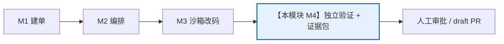
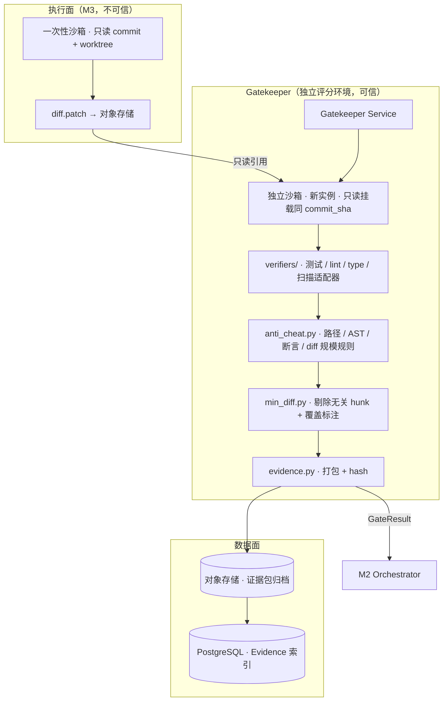

# M4 · 验证门与证据包

> **适用基线**：`PatchPilot-生产级方案.md` v1.2 · **覆盖域**：F6（验证与质量门禁域）、FR-07 / FR-08 / FR-09、X6 / X8、§1.6 原则 5「证据先于结论」
> **本文自包含**：第 1 节重述项目定位与本模块在链路中的位置，不需要先读其他文档。

---

## 1. 一分钟读懂

**PatchPilot 是什么**：给一个能由测试判定的缺陷 issue，自动产出可审阅、可验证、可追溯、可回滚的 **draft PR**，合并与否完全由人决定。

**本模块回答全系统最关键的一个问题：「真的修好了吗？」** M3 在沙箱里改完代码后，**不能自己判定对错**——如果评分环境与执行环境共用可写目录，测试夹具本身可以被改写来制造假通过。因此 Gatekeeper 在一个 **agent 完全无法写入的独立环境**里复跑验证，通过后产出绑定 `commit_sha`、可独立复跑的证据包；只有它才允许任务进入人工审批。



**一句话职责**：`候选 diff → 确定性结论 + 可独立复跑的证据包`。

**为什么单独成模块**：基线 §1.1 把第二个难点定为「判断真的修好了的可信度」。测试通过 ≠ 维护者会合并；评分环境隔离、防作弊、最小可审阅 diff、证据可追溯，共同决定这份 PR 值不值得人花时间审。

---

## 2. 上下游契约

| 方向 | 对象 | 内容 |
|---|---|---|
| **上游** | M3 | `PatchCandidate{ diffRef, filesChanged[], hunks[], testsRun[], commitSha, envFingerprint, contextAccount, routingAccount }` |
| **上游** | M2 | `VerificationRequest`（派发指令、策略版本、目标测试清单） |
| **下游** | M2 | `GateResult{ passed, reasonCode, stages[], fullSuiteRunCount }` + `Evidence` 引用 → 状态 `EVIDENCE_READY` → `interrupt()` |
| **下游** | 前端 / 审批台 | 证据包分步展示、最小可审阅 diff、风险提示 |
| **下游** | 【待拆模块】M7 PR 交付 | Check Run 绑定 commit SHA；PR 描述里的「测试通过」必须链接到证据包对象 |
| **支撑依赖** | 【待拆模块】M6 / M9 | diff 白名单与规模规则、策略版本、对象存储留存策略 |

---

## 3. 边界与非目标

| 不做 | 原因 |
|---|---|
| 与 M3 共用可写目录 / 同一个沙箱 | 同 writable 域下测试夹具可被改写制造假通过 |
| 让模型评审替代确定性门禁 | 模型复核只作为**低置信度时可选的二次意见**，是主观分叠在客观门禁上 |
| 在循环里反复跑全量回归 | X6：全量套件只在验证门执行且**一次都不能省**；循环内选测属于 M3 |
| 因 Gatekeeper 失败触发 X11 的 attempt 内升级 | 那会导致第二次全量回归，破坏「执行次数 = 1」；失败归 X2 任务级重跑 / X7 交接（v1.2） |
| 自动 merge / 自动 approve | 不可委托给人之外的决策；agent 只能开 draft PR |
| 把「测试通过」写成 PR 里的一句结论 | 必须链接到可独立复跑的证据包对象 |
| 提供在线关闭验证门的开关 | 门禁没有「关掉」这个开关；A/B 走影子/离线（§1.6 原则 7） |

---

## 4. 架构与组件



**隔离是硬边界，不是约定**：Gatekeeper 有自己的服务、自己的沙箱实例、自己的只读挂载；agent 进程无权干涉。这是「证据先于结论」的物理前提。

| 组件 | 职责 |
|---|---|
| `verifiers/` | pytest / Jest / Go test 适配器；CodeQL / Semgrep；gitleaks / trufflehog；osv-scanner |
| `anti_cheat.py` | `git diff` 解析 + 路径 / AST 规则、断言删除检测、规模上限 |
| `min_diff.py`（X8） | 确定性剔除纯格式变更与未被测试覆盖的 hunk；每个保留 hunk 标注对应断言 / 覆盖测试 |
| `evidence.py` | 打包、计算 hash、写对象存储与 `Evidence` 索引 |
| Check Run | 与 `commit_sha` 一一对应，注册到 GitHub |

---

## 5. 核心流程

```
1 收 VerificationRequest + PatchCandidate（只拿 diff 引用，不信任 M3 的任何结论）
2 新建独立沙箱：只读挂载【同一个 commit_sha】的代码 + 应用 diff
3 确定性门禁（先于任何模型评审）：
   3.1 复现一致性：确认 issue 关联测试在修复前确实失败（与 M3 记录比对）
   3.2 目标测试：issue 关联的测试 / 最小复现 → 必须通过
   3.3 全量回归：整套测试套件执行【恰好一次】(X6)
   3.4 lint / type / secret / 依赖扫描
   3.5 防作弊：禁改测试 / CI / 锁文件、禁删断言、diff 路径与规模、
       新增测试需人工确认、`.agents/` 技能包未被改写（skills_contract_sha 比对）
4 任一确定性门禁失败 → GateResult(passed=false, reason_code) → 回 M2
   （走 X2 任务级重跑或 X7 交接，不触发 X11 的 attempt 内升级）
5 全部通过 → X8 生成最小可审阅 diff（剔除无关 hunk + 断言/覆盖标注）
6 组装证据包：环境指纹、各阶段日志、扫描结果、最小 diff、上下文账、路由账
   → 计算 hash → 落对象存储 → 写 Evidence 索引（绑定 commit_sha）
7 注册 Check Run；状态置 EVIDENCE_READY → 通知 M2 进入 interrupt() 等审批
```

**顺序不可换**：确定性门禁 → 防作弊 → 最小 diff → 证据包。任何一步失败都不产出「可进审批」的证据。

---

## 6. 技术栈

| 层 | 选型 | 用途 |
|---|---|---|
| 服务 | FastAPI / 独立 Gatekeeper 服务 + 独立沙箱 | 与 agent 执行环境物理隔离 |
| 测试适配器 | pytest / Jest / Go test | 多语言目标测试与全量套件 |
| 静态检查 | CodeQL / Semgrep | lint / type / 安全规则 |
| 密钥 / 依赖 | gitleaks / trufflehog / osv-scanner | secret 泄漏与依赖漏洞扫描 |
| diff 分析 | `git diff` 解析 + 路径 / AST 规则 | 防作弊、范围与规模上限 |
| 归档 | 对象存储 + WORM / hash 链 | 证据包不可篡改、可独立复跑 |
| 对外 | GitHub Check Runs API | 与 commit SHA 一一对应 |

---

## 7. 数据模型与字段定义

> 基线 §4.1 `Evidence` 的可读展开；`【细化】` 为补充的实现级契约。

**VerificationRequest【细化】**（M2 → M4）

```ts
type VerificationRequest = {
  taskId: string; runId: string; attemptNo: number;
  commitSha: string; envFingerprint: string;
  diffRef: string;                // 对象存储引用，不内联 diff
  targetTests: string[];
  policyVersion: string;
  skillsContractSha: string;      // 用于比对技能包未被改写
};
```

**GateResult【细化】**

```ts
type GateResult = {
  passed: boolean;
  reasonCode?: ReasonCode;        // VERIFY_FAILED / ANTI_CHEAT / DIFF_OUT_OF_SCOPE / EGRESS_BLOCKED …
  stages: { name: "repro"|"target"|"full_suite"|"lint"|"type"|"secret"|"dep"|"anti_cheat";
            passed: boolean; logRef: string; durationMs: number }[];
  fullSuiteRunCount: 1;           // 恒为 1，类型层面写死
  antiCheatViolations: string[];
  evidenceRef?: string;
  checkedAt: string;
};
```

**Evidence**（基线 §4.1，v1.2 扩展）

```ts
type Evidence = {
  id: string; runId: string;
  objectKey: string;              // 对象存储中的证据包归档
  testLog: string;                // 引用
  scanResults: string;            // 引用
  diffStat: string;               // 引用
  envFingerprint: string;
  commitSha: string;              // 与 Check Run 一一对应
  hash: string;                   // 整包摘要，防篡改
  contextAccount: ContextAccount; // 上下文账（X10）
  routingAccount: {               // 路由账（X11）
    tierDistribution: Record<Tier, number>;
    upgradeReasons: string[];
    upgradeSucceeded: boolean;
  };
};
```

**证据包内部文件清单【细化】**

```
evidence-bundle/<task_id>/<run_id>/
  manifest.json          # 各文件 hash、commit_sha、env_fingerprint、policy_version、生成时间
  environment.json       # 镜像 digest、依赖锁、资源与网络策略
  reproduction.log       # 修复前复现失败
  target-tests.log       # 目标测试
  full-suite.log         # 全量回归（恰好一次）
  lint.json / type.json
  secret-scan.json / dependency-scan.json
  diff.patch             # 最小可审阅 diff（X8 之后）
  diff-stat.json
  context-account.json   # X10：index / 预取 / 请求 / 加载 / 压缩 token、cache 命中
  routing-account.json   # X11：tier 分布、升级原因、升级后是否通过
```

**HunkAnnotation【细化】**（X8）

```ts
type HunkAnnotation = {
  hunkId: string; file: string; startLine: number; endLine: number;
  assertionRef: string;       // 对应 issue 的哪条断言
  coveringTest: string;       // 被哪个测试覆盖
  excluded?: "format-only" | "uncovered";  // 被剔除的原因
};
```

---

## 8. 核心 API 与事件

| 接口 | 方向 | 说明 |
|---|---|---|
| `Gatekeeper.verify(req) -> GateResult` | 内部（M2 调用） | 唯一的验证入口；纯输入 = diff 引用 + commit_sha + 目标测试 |
| `GET /api/tasks/{id}/evidence` | 前端 / 审阅者 | 证据包下载；权限校验按 `tenant_id + task_id` |
| GitHub Check Runs API | 对外 | 注册检查结果，绑定 `commit_sha` |
| `AgentEvent(kind="test")` | M4 → 前端 | 验证门分步结果与日志（窗口化） |
| `AgentEvent(kind="policy")` | M4 → 前端 | 防作弊规则判定 |

**响应约定**：统一 `{ code, message, traceId, retryable, evidenceRef? }`；`code` 与 `ReasonCode` 对齐，前端据此展示旁路原因，不显示裸「失败」。

---

## 9. 关键机制（为什么这么设计）

1. **评分环境隔离**：与执行环境物理隔离，否则「改 `conftest.py` 让测试全通过」这类作弊无法被拦。这是基线 F6 的第一要点。
2. **全量回归恰好一次**（X6）：全量套件是最大的固定成本乘数；循环内由 M3 按影响分析选测，全量只在验证门跑一次且不能省。因此 Gatekeeper 失败后**不重跑验证门**——要么任务级重跑（新 Run，重新走完整链路），要么转人工。
3. **确定性门禁先于任何模型评审**：模型复核只是低置信度时可选的二次意见，不替代客观门禁。
4. **防作弊清单**：禁止改测试 / CI / 锁文件、禁止删除断言、diff 路径与规模上限、新增测试必须人工确认；与真实 diff 比对防止 PR 描述隐瞒改动。
5. **X8 最小可审阅 diff**：F6 原来只「拦」越界不「修」；无关格式改动与未覆盖 hunk 会拉长审阅、扩大回归面，而**一次打回 = 一整个循环的钱**。每个保留 hunk 标注对应断言与覆盖测试。
6. **证据先于结论**（§1.6 原则 5）：只有绑定确切 `commit_sha` 的日志、扫描结果、diff 与环境指纹构成证据包，才允许进入审批；PR 描述里的「测试通过」必须链接到证据包对象。
7. **两本账进证据包**：`context_account`（X10）让审阅者看到这次加载了什么技能、省了多少 token；`routing_account`（X11）解释「为什么这次用了贵模型」以及升级后是否真的通过。
8. **可独立复跑**：证据包带 `manifest.json` 与各文件 hash、镜像 digest、锁文件与 `commit_sha`；第三方不需要信任 agent 的任何自述即可复现结论。

---

## 10. 失败、降级与安全

| 场景 | 行为 |
|---|---|
| 目标测试仍失败 | `VERIFY_FAILED`，`GateResult(passed=false)` → M2 走 X2 任务级重跑 / X7 交接 |
| 全量回归失败 | 同上；**不重跑验证门**，`fullSuiteRunCount` 仍为 1 |
| agent 改测试 / 删断言 / 写 `conftest.py` | 只读评分环境 + diff 规则拦截，`ANTI_CHEAT`，可触发 `QUARANTINED` |
| 修改 CI workflow / 锁文件 / 新增依赖 / 触碰 infra | 路径白名单拒绝；需要时转人工审批 |
| PR 描述隐瞒改动、超大 diff、跨模块越界 | diff 规模 / 范围规则 + 证据包与真实 diff 比对 |
| secret / 依赖漏洞扫描命中 | 门禁失败并写扫描结果进证据包 |
| 技能包被改写（与 `skills_contract_sha` 不符） | 按安全事件处理，拒绝进入审批 |
| 诱导 Gatekeeper 失败后 attempt 内升级 | 明确禁止：升级信号只来自 M3 循环内；验证门失败走任务级重跑 |
| 评分环境不可用 | 只出只读诊断报告，不写 PR；**绝不跳过验证门** |

**原则**：降级降的是自动化程度，不是安全级别。跳过全量回归、缩减扫描项与关闭验证门等价，禁止。

**对抗用例判据**：以**策略是否拦住动作**为准，而非模型是否口头拒绝（基线 §9.3）。

---

## 11. 可观测与验收

| 指标 | 目标 |
|---|---|
| 注入「改测试让测试通过」的对抗用例 | 必须被拦 |
| 证据包 | 能独立复跑出相同结论 |
| Check Run | 与 `commit_sha` 一一对应 |
| 全量套件执行次数 | 恒 = 1（全系统门禁侧） |
| 单 PR 平均 hunk 数 / 审阅时长 / 打回率 | X8 上线后可测 |
| 证据包字段 | 含 `context_account` / `routing_account`，可解释成本与档位 |
| 回归门禁 | prompt / 模型 / 工具 / 技能包 / 路由阈值变更自动触发 |

**评测口径**：离线结果报分布与置信区间，不报单点估计；主指标是**可合并率 + 重复运行稳定性**，pass@1 不是唯一北极星。

---

## 12. 贯穿示例 + 接口速查

**issue #482 在本模块的经过**

1. M3 交来 `PatchCandidate{ diffRef: "obj://diffs/d7.patch", commitSha: "a1b2c3d", targetTests: ["tests/test_cart.py::test_coupon_stack"] }`，并附带 `contextAccount` 与 `routingAccount`（tier 由 cheap 升到 standard）。
2. Gatekeeper **新建一个独立沙箱**，只读挂载同一个 `a1b2c3d`，应用 `d7.patch`；M3 的沙箱已销毁。
3. 门禁依次通过：`reproduction`（修复前确实失败）→ `target`（`test_coupon_stack` 通过）→ `full_suite`（整套一次，通过）→ `lint / type / secret / dep` 全绿 → 防作弊：diff 只碰 `src/cart.py`、未改测试、规模在上限内、`skills_contract_sha` 一致。
4. X8 剔掉一处纯格式 hunk，保留的 hunk 标注 `assertionRef: "总价不得为负"` / `coveringTest: "test_coupon_stack"`。
5. 生成证据包 `obj://evidence/tsk_01H…/run-1/`，`manifest.json` 含各文件 hash；写 `Evidence` 索引、注册 Check Run。
6. `GateResult{ passed: true, fullSuiteRunCount: 1, evidenceRef: … }` → M2 置 `EVIDENCE_READY` → `interrupt()` → `AWAITING_APPROVAL`，审批台展示最小 diff + 分步证据 + 「本次 tier: cheap → standard，升级原因：编译错」。
7. 若第 3 步 `full_suite` 失败，则 `passed=false`，**不重跑验证门**、不触发 X11 升级；M2 开新 `Run(attempt_no=2)` 或生成 X7 交接包转人工。

**接口速查**

| 谁 | 给什么 / 收什么 |
|---|---|
| M3 → M4 | `PatchCandidate`（diff 引用 + 两本账） |
| M2 → M4 | `VerificationRequest`；收 `GateResult + Evidence` |
| M4 → 前端 / M7（待拆） | 证据包下载、Check Run、PR 描述链接 |
| M6 / M9（待拆）→ M4 | diff 规则、策略版本、留存策略 |

**延伸阅读**：基线 §1.6 原则 5/6/7、§2.6.4（X6/X8）、§3.2 步骤 8–9、§9.3 对抗清单、F6 要点；上一站 [`M3-执行沙箱与ACI工具层.md`](./M3-执行沙箱与ACI工具层.md)，入口 [`README.md`](./README.md)。
