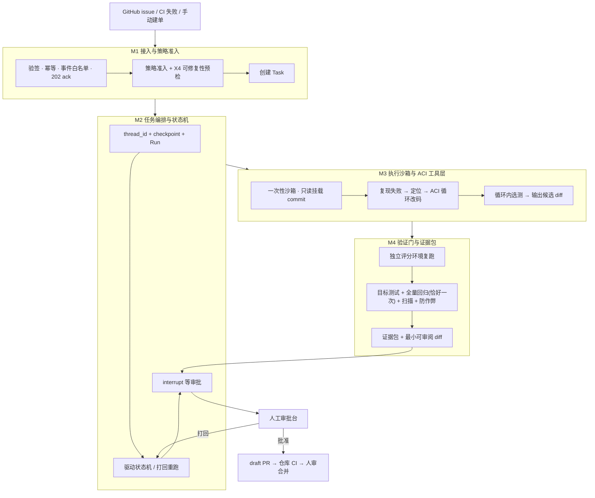
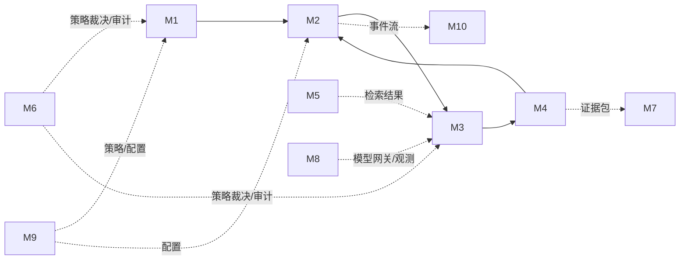

# PatchPilot · 模块化设计阅读指南（M0）

> **这是整个文档集的入口。** 不知道 PatchPilot 是什么的人，读完本文应能说清：这个项目解决什么问题、一个 issue 从进来到出 PR 经过哪些环节、每个模块负责哪一段、模块之间靠什么契约衔接。
> **权威设计基线**：[`PatchPilot-生产级方案.md`](../plan/PatchPilot-生产级方案.md)（v1.2）。本目录是按模块展开的**可读版本**，不引入新的架构决策；两者冲突时以基线为准。

---

## 1. 这个项目是什么（30 秒版）

**PatchPilot 是一个接入现有研发流程的后台服务**：给它一个「能由测试判定」的缺陷 issue，它自动完成读 issue → 搭环境 → 复现 → 定位 → 改码 → 跑回归 → 开 PR，产出一份**可审阅、可验证、可追溯、可回滚的 draft PR**。**合并与否完全由人决定**，系统只开草稿 PR。

| 它做 | 它不做 |
|---|---|
| 处理能由测试判定的缺陷修复 | 通用聊天助手、IDE 插件 |
| 产出带完整证据包的 draft PR | 自动 merge、自动触发生产部署 |
| 让维护者观察、暂停、打回、接管、审阅 | 处理无法由测试判定的开放式需求 |
| 把安全边界做成可证明的 | 把客户代码发到不受控第三方（提供自托管 / 全本地路径） |

**为什么难**（这三件事决定了后面所有模块的形状）：

1. **执行不可信代码的安全性** —— issue 正文、依赖文档、测试输出都是不可信输入，模型生成的代码是不可信执行体。
2. **判断「真的修好了」的可信度** —— 测试通过 ≠ 维护者会合并；而且如果评分环境和执行环境共用可写目录，测试夹具本身可以被改写来制造假通过。
3. **长任务与人工审批的可恢复性** —— 任务会跑很久、会等人审批、worker 会被杀，状态和副作用必须可恢复且不重复。

---

## 2. 端到端链路（先记住这张图）



对应基线文档 §3.2 的 12 步时序。**关键的不变量**（贯穿所有模块）：

- **确定性门禁高于模型自律**：护栏在工具层、策略引擎、CI 与分支保护里，不写在 prompt 里。
- **证据先于结论**：只有绑定确切 `commit_sha` 的测试日志、扫描结果、diff 与环境指纹构成证据包，才允许进入审批。
- **控制面与执行面隔离**：模型生成的代码绝不在跑编排图的进程里执行；评分环境与执行环境物理隔离。
- **不可委托给人之外的决策**：agent 不能 author + approve + merge + deploy 同一变更。
- **门禁没有「关掉」这个开关**：所有 A/B 对照走影子模式或离线回放。

---

## 3. 贯穿全篇的例子

后面每份模块文档都会用同一个例子走一遍自己那一段，方便对照：

> 仓库 `acme/order-service`，issue **#482**「优惠券叠加时总价计算错误」，被打上 `auto-fix` 标签，关联测试 `tests/test_cart.py::test_coupon_stack`，触发时仓库 HEAD 为 `a1b2c3d`。
> 预期结果：系统定位到 `src/cart.py::apply_coupon`，改一处边界判断，跑通目标测试与全量回归，产出 draft PR 与可独立复跑的证据包；维护者审阅后决定合并。

| 模块 | 这个例子里发生什么 |
|---|---|
| M1 | 收到 `issues.labeled` 事件，验签、去重、策略通过，冻结预算，创建 `Task(tsk_…, state=QUALIFIED)` |
| M2 | 建 `thread_id = tsk_…`、`Run(attempt_no=1)`，派发执行；验证通过后 `interrupt()` 挂起等审批；被打回则开 `Run(attempt_no=2)` |
| M3 | 一次性沙箱只读挂载 `a1b2c3d`，复现 `test_coupon_stack` 失败，`view`/`search`/`edit`/`run_tests` 循环改码，产出候选 diff |
| M4 | 在**另一个**独立沙箱复跑，目标测试 + 全量套件各一次，扫描 + 防作弊，生成证据包与最小可审阅 diff，状态置 `EVIDENCE_READY` |

---

## 4. 模块地图

| 编号 | 模块 | 覆盖基线文档的域 / 能力 | 状态 |
|---|---|---|---|
| **M0** | 阅读指南与全局链路（本文） | §1 产品概述 / §3.2 时序 | ✅ 本轮 |
| **M1** | 接入与策略准入 | F1、FR-01/02/24、X4 | ✅ 本轮 |
| **M2** | 任务编排与状态机 | F2、§4.2/§4.4、X2/X5/X7 | ✅ 本轮 |
| **M3** | 执行沙箱与 ACI 工具层 | F3 + F4、X1/X6/X10/X11 | ✅ 本轮 |
| **M4** | 验证门与证据包 | F6、FR-09、X8 | ✅ 本轮 |
| M5 | 代码检索与上下文 | F5、FR-06 | 待拆 |
| M6 | 安全治理与审计 | F7、FR-10、§9.3 | 待拆 |
| M7 | PR 交付与回滚 | F8、FR-11 | 待拆 |
| M8 | 可观测、评测与灰度 | F9、FR-13/14、§9.1 | 待拆 |
| M9 | 平台与多租户 | F10、FR-15 | 待拆 |
| M10 | 控制面前端 | W1–W7、§6 | 待拆 |
| M11 | 横切能力规格 | X1–X11（§2.6） | 待拆 / 可作附录 |

**本轮为什么先拆 M1–M4**：它们构成一条**最短可验证闭环**——「事件进来 → 有任务 → 有执行 → 有可信结论 → 能进审批」。M5–M11 都是在这条骨架上增强能力或提供界面；先读懂骨架，再读增强项不会迷路。

**模块依赖（谁依赖谁）**



> 虚线 = 支撑/配置依赖，实线 = 主链路数据传递。M6 / M9 / M8 尚未拆，但 M1–M4 的文档中会明确标出「此处依赖哪个待拆模块提供什么」，不留下悬空引用。

---

## 5. 什么叫「一个模块是完整闭环的」

每份模块文档必须独立回答以下 7 个问题；**不要求先读别的模块文档**：

| # | 问题 | 对应章节 |
|---|---|---|
| 1 | 这个项目在做什么、本模块在链路的哪一段 | §1 一分钟读懂 + 链路定位图 |
| 2 | 谁给我输入、我给谁输出，契约长什么样 | §2 上下游契约（含字段） |
| 3 | 本模块明确不做什么 | §3 边界与非目标 |
| 4 | 内部由哪些组件构成、数据怎么流 | §4 架构 |
| 5 | 一次调用/一个任务在内部怎么走完 | §5 核心流程与状态 |
| 6 | 用什么技术、对外暴露哪些 API、核心字段怎么定义 | §6 技术栈 / §7 字段与 API |
| 7 | 出错怎么办、怎么算做对了 | §9 失败与降级 / §10 验收 |

**统一模板**（每份文档固定 12 节）：

```
1 一分钟读懂（含链路定位）
2 上下游契约
3 边界与非目标
4 架构与组件
5 核心流程 / 状态机
6 技术栈
7 数据模型与字段定义
8 核心 API 与事件
9 关键机制（本模块的"为什么这么设计"）
10 失败、降级与安全
11 可观测与验收
12 贯穿示例 + 接口速查 + 延伸阅读
```

第 1 节每份都会重复一句项目定位和一张**高亮本模块**的链路简图——这是刻意的冗余，目的是让单独拿到某一页的人也能读懂。

---

## 6. 术语表（读任何一份前先看这里）

| 术语 | 含义 |
|---|---|
| **Task** | 一条任务主记录，对应一个 issue 的一次自动修复诉求；`state` 走状态机 |
| **Run / attempt** | 一次执行尝试。打回重跑 = 新 Run，独立记录、成本单独记账 |
| `thread_id` | 编排工作流的标识，恒等于 `task_id`；checkpoint 按它存取 |
| **checkpoint** | LangGraph 持久化的状态快照；只存状态，不等于崩溃自动续跑（那是 Temporal） |
| **控制面 / 执行面** | 前者跑 API 与编排图，后者是每任务一次性沙箱；两者不共享进程/文件系统/凭证 |
| **ACI 工具** | 面向模型设计的受限工具集：`view / search / edit / run_tests`，只有这四个 |
| **执行面（surface）** | `locator / coder / gatekeeper` 三种权限与上下文隔离面，不是三个 agent 角色 |
| **Gatekeeper / 验证门** | 独立评分环境中的确定性门禁，agent 进程无权干涉 |
| **证据包** | 绑定 `commit_sha` 的测试日志、扫描结果、diff、环境指纹与两本账，可独立复跑 |
| **draft PR** | agent 唯一允许创建的交付物；不能 approve / merge |
| **interrupt()** | 编排在审批点的挂起，等待期间不占计算资源 |
| **SSE / seq** | 前端实时事件流与单调递增序号，支持断线续传与回放 |
| **tier** | X11 中 coder 的模型档位：`cheap / standard / frontier` |
| **skill** | X10 中按阶段确定性预取的仓库技能包，不是可被模型自由检索的目录 |
| **X1–X11** | 横切能力编号（上下文、可靠性、成本、效率与 v1.2 的技能披露/路由），见基线 §2.6 |

---

## 7. 按角色阅读

| 你是 | 建议路径 |
|---|---|
| 完全不了解项目 / 面试前通读 | M0 → M1 → M2 → M3 → M4（本轮全部），再看基线 §1 / §3.4 |
| 后端 / 平台 | M1 → M2 → M3 → M4，重点看 §7 字段与 §8 API |
| 前端 | M0 → M2（状态机与事件流）→ M4（证据包结构）→ 后续 M10 |
| 安全 / 运维 | M0 → M3（隔离边界）→ M4（防作弊）→ 基线 §2.3 / §9.3 |
| 只关心某一模块 | 直接打开对应文档，第 1 节自带项目定位与链路 |

---

## 8. 契约与版本规则

- **单一事实来源**：`packages/contracts`（OpenAPI 3.1 + 事件 JSON Schema / Zod + 状态与原因码枚举 + `SkillManifest` / `RoutingDecision` / `TierHistoryEntry`）。模块文档里的字段定义是该契约的**可读说明**，实现以生成结果为准。
- **编号对齐**：模块文档中的 F* / W* / X* / FR-* 编号与基线文档 §8 总表一一对应，不另起编号。
- **版本**：模块文档跟随基线版本 v1.2；基线升版时，先改基线，再同步受影响的模块文档。
- **标注约定**：`【细化】` 表示该定义是在基线原则下补充的实现级契约（例如具体 API body、表结构），不是新增架构决策；`【待拆模块】` 表示该能力由后续模块文档展开。

---

## 9. 本轮交付文件

| 文件 | 内容 |
|---|---|
| `README.md` | 本文（M0）：全局链路、模块地图、模板、术语、阅读路径 |
| `M1-接入与策略准入.md` | webhook → Task 的完整闭环 |
| `M2-任务编排与状态机.md` | Task → Run → 挂起/打回/续跑的完整闭环 |
| `M3-执行沙箱与ACI工具层.md` | 派发 → 候选 diff 的完整闭环 |
| `M4-验证门与证据包.md` | 候选 diff → 可信结论 → 证据包的完整闭环 |

后续模块按 §4 地图继续拆，每新增一份都保持同一模板，并回填到本表。
